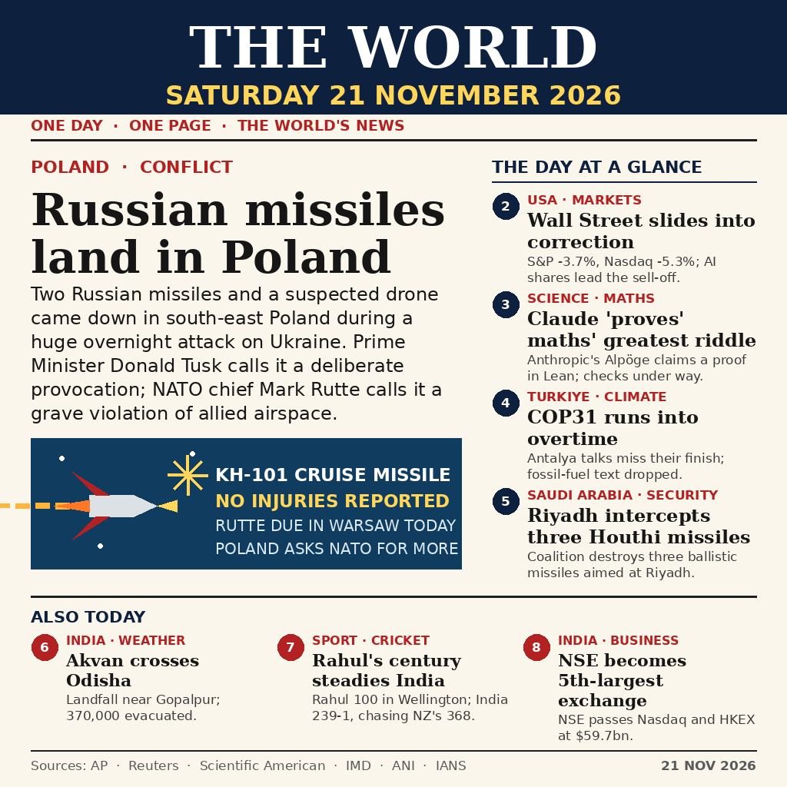

# The World — Saturday 21 November 2026

[](https://make.fun/bounty/news-image-20261121?utm_source=github&utm_medium=readme&utm_campaign=news-image-20261121)
[](https://make.fun/bounty/news-image-20261121/leaderboard?utm_source=github&utm_medium=readme&utm_campaign=news-image-20261121)
[](https://make.fun/bounty/news-image-20261121?utm_source=github&utm_medium=readme&utm_campaign=news-image-20261121)

A one-page newspaper front page summing up the world news of
**Saturday 21 November 2026** in a single image.



## What the image shows

The front page of "THE WORLD", dated Saturday 21 November 2026, with
eight verified stories from the day:

1. **Russian missiles land in Poland** — Two Russian missiles and a
   suspected drone came down in south-east Poland during a huge
   overnight attack on Ukraine. PM Donald Tusk calls it a deliberate
   provocation; NATO chief Mark Rutte calls it a grave violation.
   (AP / Reuters)
2. **Wall Street slides into correction** — The S&P 500 fell 3.7% on
   Friday, more than 10% below its October record. The Nasdaq sank
   5.3% as AI shares sold off; Nvidia fell 14% on a reported SEC
   probe. (AP / Motley Fool)
3. **Claude 'proves' maths' greatest riddle** — Anthropic
   mathematician Levent Alpöge says he proved the Riemann Hypothesis
   working with Claude, releasing the proof in Lean. Independent
   checks are under way; a second, human-only claim appeared the same
   day. (Scientific American)
4. **COP31 runs into overtime** — The UN climate talks in Antalya
   missed their Friday finish. The draft drops fossil-fuel language
   and a $120bn adaptation target; a new draft is due this morning.
   (AP / BNN Bloomberg)
5. **Riyadh intercepts three Houthi missiles** — The Saudi-led
   coalition says it destroyed three ballistic missiles fired towards
   Riyadh on Saturday — the second attack on the capital in days.
   (Reuters)
6. **Akvan crosses Odisha** — The cyclone came ashore near Gopalpur
   with winds of 70–80 km/h. Some 370,000 people were evacuated;
   officials report no major damage. (IMD)
7. **Rahul's century steadies India** — KL Rahul reached 100 on day
   three in Wellington, his first Test century in New Zealand, as
   India reached 239-1 chasing the hosts' 368. (AP / IANS)
8. **NSE becomes 5th-largest exchange** — India's National Stock
   Exchange passed Nasdaq and Hong Kong's HKEX by market value, at
   about $59.7bn, two months after listing. (ANI)

Every story was checked against reporting dated to 21 November 2026;
the Riemann claim is worded as a claim, not a confirmed proof, and
stories first reported on 20 November (the ICJ Myanmar ruling, the US
Senate Iran vote) were deliberately left out. See NOTES.md for the
research, the variant comparison, and the sources.

## How to run

```sh
python3 main.py
```

This writes the image to `$MAKEFUN_OUTPUT_DIR/entry.png`
(default `/output/entry.png`). The program is standard library only,
needs no network, and writes the same bytes on every run — the image
is embedded in `main.py` as base64.

## Files

- `main.py` — the entry program (stdlib only, embeds the image)
- `entry.png` — the winning image, 1024×1024 PNG
- `build.py` — the script that drew all three variants with PIL
- `variant-v1.png`, `variant-v2.png`, `variant-v3.png` — the three
  variants built and compared (v1 won)
- `NOTES.md` — research, sources, and why v1 was chosen
- `LICENSE` — MIT

## License

MIT — see [LICENSE](LICENSE). Copyright (c) 2026 Donovan Entiman.
